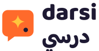

<p align="center">
  <picture>
    <source media="(prefers-color-scheme: dark)" srcset="packages/design-system/assets/logos/darsi-lockup-bilingual-inverse.svg">
    
  </picture>
</p>

<h3 align="center">Five-minute lessons in AI, IoT and cyber security for teachers,<br>in their own language, on the phone they already have, even offline.</h3>

<p align="center" dir="rtl">دروس من خمس دقائق في الذكاء الاصطناعي وإنترنت الأشياء والأمن السيبراني للمعلمين،<br>بلغتهم، على الهاتف الذي يملكونه، حتى دون اتصال.</p>

<p align="center"><a href="https://darsiai.org"><b>Open Darsi</b></a> · <a href="TECHNICAL.md">Technical overview</a> · <a href="docs/FIREBASE.md">Deploy</a></p>

---

## Why Darsi exists

Every school is now expected to teach children about artificial intelligence, connected devices and staying safe online. The people asked to do it are teachers, and most of them never had a chance to learn these subjects themselves.

The training that does exist usually assumes things many teachers don't have: a laptop, a fast and cheap internet connection, hours of free time, and fluent English. In much of the world, a teacher's reality looks different:
- one Android phone, often shared with the family;
- mobile data paid for by the megabyte;
- a classroom with no projector and sometimes no electricity;
- a working week with no room for a two-day course.

Darsi is built for that teacher. It takes the training to them in their own language, five minutes at a time, and every lesson ends with something they can **use in class tomorrow**.

We treat teachers as professionals, not as charity cases. The goal isn't awareness; it's teachers who are confident enough to teach these subjects well.

## The name

*Dars* means "lesson" across a wide belt of the world, so the name is understood far beyond Arabic:

- **درسي** *darsi*: "my lesson" in Arabic
- **درسی**: "of the classroom" in Persian and Dari
- **درس** *dars* in Urdu, *ders* in Turkish, *darasi* in Hausa, *darasa* ("class") in Swahili

It has two syllables, is easy to say in English, French, Portuguese or Hindi, and is spelled the same everywhere in Latin script.

## What a teacher gets

- **Five-minute lessons.** Each one follows the same shape: watch a short video (or read the transcript to save data), practise with mixed questions, get feedback that explains *why*, reflect, and finish with "Try it in class tomorrow".
- **Three tracks**, each in four levels: **AI**, **IoT** (sensors and connected devices) and **cyber security**. The competencies map to the UNESCO AI Competency Frameworks for teachers and for students, to the EU's DigComp 2.2, and to Darsi's own IoT strand. A nine-question placement check suggests where to start.
- **A classroom kit for every lesson.** Slides (PDF and editable PowerPoint), a lesson plan and a pupil worksheet in the teacher's language. They are printable in black and white, include activities that need no devices or electricity, and are free to copy for your school.
- **Labs.** 48 hands-on apps across all three tracks, each a few minutes long. Teach one neuron, then train whole networks, see how a computer reads pictures and text, follow an LLM writing word by word, and build decision trees and a robot that learns by reward. Wire logic gates and LED circuits, log sensor data, and plan a farm's mesh network. Crack a Caesar cipher, sign in with real one-time codes and spot scam messages. Everything really computes on the phone, works offline, and uses reviewed examples, so no learner ever sees unreviewed AI output. Any lab can also be a step in a lesson.
- **Real projects.** Each lesson can end with a task for the teacher's own classroom, which a colleague or trainer can review.
- **Progress that encourages.** Streaks count *teaching weeks*, not days; missing a week pauses the streak and never resets it. Teachers earn certificates per track and level, which they can show their school leaders.

## For schools, ministries and NGOs

An organization can register on Darsi. Once approved, its admins get:
- **Invite codes** for teachers and students, plus **bulk account creation** from an Excel or CSV list. People without email get a username and a printable **login slip**.
- **A people dashboard:** who is active, lessons completed, accuracy, and **capability coverage** (the share of staff with evidence for each competency).
- **Project review**, and a personal page per teacher or student showing their capabilities and finished courses.
- **For teachers:** their own student list, so they can follow and review their students.

## Principles

1. **Teacher first, tech second.** Every lesson ends with something usable in class tomorrow.
2. **Every language is a first language.** Arabic screens are designed, not translated afterwards. Right-to-left is a default path, not an edge case, and numbers follow the teacher's locale.
3. **Offline is normal.** After the first visit the app opens with no signal, and downloaded units keep working. Progress is saved on the phone and syncs when a connection returns.
4. **Light on data, light on battery.** No live connections or polling, no autoplay, flat colour and SVG, and sizes shown in MB before every download.
5. **Encourage, never punish.** Mistakes come back for another try; nothing resets with a guilt message.

## Built for the phones teachers actually have

| | |
|---|---|
| **Install size** | About 715 KB for an English teacher and 845 KB for an Arabic one, fonts included: each phone keeps only the fonts for its own language. Guests never download the account and sync code; it loads only when someone signs in. Admin tools and the spreadsheet importer load only for the people who use them. |
| **Data** | Progress syncs with one small read per sign-in; photos are shrunk on the phone (often from 3 MB to around 250 KB) before upload. |
| **Old phones** | Styles work on older Android WebViews, every tap target is at least 48 px, and **Sunlight mode** gives high contrast for outdoor classrooms. |
| **No account needed** | Teachers can start learning straight away as guests. When they create an account later, their progress comes with them. |

## Where we are

**Live now:** the full learning experience in English and Arabic, the first AI unit, Labs, classroom kits, offline downloads, accounts, organizations, and the admin and teacher dashboards.

**Next:**
- narrated lesson videos in each language;
- the first IoT and cyber-security units;
- more languages (French, Swahili, Urdu, Hausa);
- Android and iOS apps from the same code;
- a full security review before wider rollout.

## Contributing and running it yourself

Darsi is a TypeScript monorepo: a React PWA, a shared design system, and a serverless backend on Google Cloud (sign-in, database, functions and hosting) at https://darsiai.org.

```bash
npm install     # also builds the design system
npm run dev     # http://localhost:5173
```

- [**TECHNICAL.md**](TECHNICAL.md): architecture, data model, offline strategy, security model, testing.
- [docs/FIREBASE.md](docs/FIREBASE.md): set up, deploy, and make yourself a platform admin.
- [docs/CONTENT.md](docs/CONTENT.md): writing lessons in English and Arabic.
- [docs/NATIVE.md](docs/NATIVE.md): building the Android and iOS apps.

<p align="center"><sub>Darsi (درسي). Made for teachers, in their language.</sub></p>
